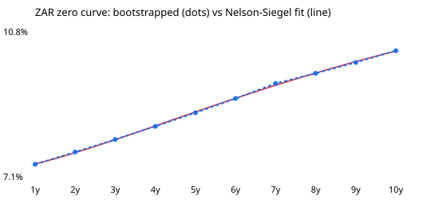

# SA rates toolkit report

Generated 2026-11-04 21:48. **All market inputs are illustrative, not live data.**

## 1. ZAR zero curve

| tenor | par_yield | zero_rate | discount_factor | nelson_siegel |
| --- | --- | --- | --- | --- |
| 1y | 7.50% | 7.500% | 0.9302 | 7.508% |
| 2y | 7.80% | 7.812% | 0.8603 | 7.795% |
| 3y | 8.10% | 8.133% | 0.7909 | 8.128% |
| 4y | 8.40% | 8.466% | 0.7225 | 8.480% |
| 5y | 8.70% | 8.813% | 0.6555 | 8.835% |
| 6y | 9.00% | 9.177% | 0.5905 | 9.181% |
| 7y | 9.30% | 9.560% | 0.5278 | 9.513% |
| 8y | 9.50% | 9.819% | 0.4727 | 9.825% |
| 9y | 9.70% | 10.096% | 0.4208 | 10.117% |
| 10y | 9.90% | 10.394% | 0.3720 | 10.387% |

Nelson-Siegel fit (SciPy least squares): beta0 (level) = 0.1443, beta1 (slope) = -0.0713, beta2 (curvature) = -0.0607, tau = 3.5497; RMSE 1.9bp. Three parameters summarise the whole curve as level, slope and curvature, which is how curve moves are usually described and traded.

## 2. Bond portfolio

| bond | face | coupon | price | ytm | mod_duration | dv01 |
| --- | --- | --- | --- | --- | --- | --- |
| 3-year bond | R50,000,000 | 8.0% | 99.74 | 8.10% | 2.57 | R-12,833 |
| 7-year bond | R80,000,000 | 9.0% | 98.48 | 9.31% | 4.97 | R-39,180 |
| 10-year bond | R70,000,000 | 10.0% | 100.63 | 9.90% | 6.05 | R-42,631 |

**Portfolio value:** R199,096,297. **DV01:** R-94,645 per 1bp. Yields to maturity are solved with SciPy's brentq root finder.

## 3. Carry and roll-down (1 year, curve unchanged)

| bond | price | carry | roll_down | carry_plus_roll |
| --- | --- | --- | --- | --- |
| 3-year bond | 99.74 | 0.52% | 0.62% | 1.14% |
| 7-year bond | 98.48 | 1.64% | 1.55% | 3.19% |
| 10-year bond | 100.63 | 2.44% | 1.15% | 3.59% |

Carry is coupon income minus the cost of funding the bond at the 1-year rate. Roll-down is the price gain from the bond ageing along an upward-sloping curve: next year it is priced at a shorter, lower-yielding point. Together they are the return earned if nothing moves, and a common starting point for relative-value comparisons along the curve.

## 4. ZARONIA swap hedge and scenarios

7-year payer swap (pay fixed 9.300%, receive compounded ZARONIA), notional **R191,265,903**, sized so its DV01 offsets the portfolio's.

| scenario | bonds | swap_hedge | net |
| --- | --- | --- | --- |
| Parallel +100bp | R-9,139,461 | R9,158,291 | R18,830 |
| Parallel -100bp | R9,809,028 | R-9,786,999 | R22,030 |
| Bear steepener (10y +100bp) | R-5,852,290 | R5,412,188 | R-440,102 |
| Bull flattener (10y -100bp) | R6,262,040 | R-5,661,525 | R600,515 |
| Twist (1y +50bp, 10y -50bp) | R1,360,836 | R-811,521 | R549,315 |

The hedge neutralises parallel moves up to a small convexity residual, but leaves curve risk under steepeners and twists, because the bonds' risk is spread across 3, 7 and 10 years while the hedge sits at 7.

## 5. US module: SOFR swaps

| tenor_years | sofr_par_swap_rate | sofr_zero_rate |
| --- | --- | --- |
| 1 | 3.900% | 3.900% |
| 2 | 3.650% | 3.645% |
| 3 | 3.550% | 3.543% |
| 4 | 3.550% | 3.545% |
| 5 | 3.600% | 3.600% |
| 6 | 3.680% | 3.688% |
| 7 | 3.760% | 3.776% |
| 8 | 3.830% | 3.855% |
| 9 | 3.890% | 3.923% |
| 10 | 3.950% | 3.992% |

An illustrative SOFR OIS curve, inverted at the front as when rate cuts are priced in. SOFR replaced USD LIBOR, as ZARONIA is replacing JIBAR.

## 6. US module: Treasury futures cheapest-to-deliver

10-year note futures price 110.50. Gross basis = cash price - futures price x conversion factor.

| note | coupon | years | price | conversion_factor | invoice_price | gross_basis | ctd |
| --- | --- | --- | --- | --- | --- | --- | --- |
| 4.000% 2032 | 4.000% | 6.5 | 100.10 | 0.8937 | 98.75 | 1.35 | True |
| 4.250% 2033 | 4.250% | 7.0 | 101.20 | 0.9012 | 99.58 | 1.62 | False |
| 3.875% 2033 | 3.875% | 7.5 | 98.55 | 0.8732 | 96.48 | 2.07 | False |
| 4.375% 2034 | 4.375% | 8.0 | 101.70 | 0.8979 | 99.22 | 2.48 | False |

The note with the lowest gross basis is cheapest to deliver; futures prices and hedge ratios track it. Simplified: no accrued interest, implied repo or delivery options.

## Notes

- JIBAR publishes for the last time on 31 December 2026; ZARONIA is its successor.
- Simplifications: annual coupons for ZAR bonds, single-curve framework, linear interpolation, illustrative inputs.